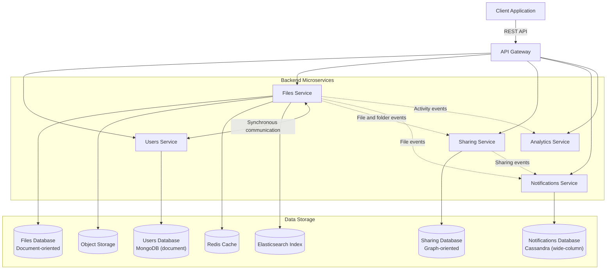

# File Storage & Sharing Platform

## Project Overview

A Google Drive-like web application for secure file storage and sharing, allowing users to upload, organize, search, download, and share files and folders with other users and groups. The platform also aims to provide user access management, storage quota management, notifications, and account activity tracking.

The project is developed as a team assignment for the following university courses:

- Service-Oriented Architectures
- NoSQL Databases
- Information Security
- Software Development Methodology

The server-side application follows a microservices architecture, with an API Gateway serving as the single entry point for client requests. Each service is designed to handle a specific business domain and runs in its own Docker container.

## Table of Contents

- [Project Overview](#project-overview)
- [Features](#features)
- [System Architecture](#system-architecture)
  - [High-Level Architecture](#high-level-architecture)
  - [Architecture Diagram](#architecture-diagram)
  - [Backend Services](#backend-services)
  - [Service Communication](#service-communication)
- [Technology Stack](#technology-stack)
- [Current Status](#current-status)
- [Prerequisites](#prerequisites)
- [Getting Started](#getting-started)
- [Configuration](#configuration)
- [API Documentation](#api-documentation)
- [Database Structure](#database-structure)
- [Project Structure](#project-structure)
- [Development Workflow](#development-workflow)
- [Troubleshooting](#troubleshooting)
- [Future Improvements](#future-improvements)

## Features

The platform is designed to provide the following functionality:

### User Management
- User registration and email verification
- Secure login with password and email-based one-time passwords (OTP)
- Password change and password recovery
- Role-based access control (regular users and administrators)
- User profile and storage quota management

### File and Folder Management
- Upload files and create new file versions
- Create and organize folders in a hierarchical structure
- Browse, rename, search, and delete files and folders
- Download files and preview supported file types
- Storage quota enforcement

### Sharing and Access Management
- Share files and folders with individual users or groups
- Create and manage user groups
- Manage group membership
- View shared content and manage sharing permissions
- Revoke previously granted access
- Inherit sharing permissions from parent folders

### Notifications
- Receive notifications when files or folders are shared
- Get notified when new files are added to shared folders
- Receive notifications when shared files are updated
- View received notifications

### Activity History and Analytics
- Track account activity, including file and folder operations
- View storage usage and file statistics
- Identify frequently accessed files
- View statistics about shared files

### Administration
- View registered users and their storage usage
- Review storage quota increase requests
- Approve or reject quota requests

## System Architecture

The application follows a **microservices architecture**, where the backend is divided into independent services, each responsible for a specific business domain.

The system consists of a client application, an API Gateway, and several backend microservices. Each service manages its own business logic and communicates with other services when necessary.

### High-Level Architecture

The main components of the system are:

- **Client Application** - provides the graphical user interface through which users interact with the platform
- **API Gateway** - acts as the single entry point for client requests and routes them to the appropriate backend service
- **Backend Microservices** - handle specific application domains, such as user management, file storage, sharing, notifications, and analytics
- **Databases and Storage** - each service uses the storage technology appropriate for the data it manages

All client-to-server communication is handled through the API Gateway, which exposes a REST API. Clients do not communicate directly with individual backend services.

### Architecture Diagram

The following diagram illustrates the main components of the system, their relationships, and the storage technologies used by individual services.



*Note: The diagram represents the intended system architecture. Components and technologies may be updated as implementation progresses.*

### Backend Services

The backend consists of the following microservices:

#### API Gateway

The API Gateway is the entry point to the backend application. It receives incoming HTTP requests from the client and forwards them to the appropriate service based on the request path.

Its responsibilities include:

- routing requests to the appropriate microservice
- providing a unified API entry point for the client
- handling communication between the client and backend services

#### Users Service

The Users service manages user accounts and authentication-related information.

Its responsibilities include:

- user registration and login
- storing user credentials and roles
- managing basic user profile information
- managing storage quotas
- providing user-related information to other services

User data is stored in a document-oriented database.

#### Files Service

The Files service manages files and folders stored on the platform.

Its responsibilities include:

- uploading and downloading files
- creating and organizing folders
- managing file and folder metadata
- handling file versions
- enforcing storage quotas in cooperation with the Users service

File metadata is stored in a document-oriented database, while the actual file content is stored in an object storage system.

#### Sharing Service

The Sharing service manages access permissions and sharing relationships between users and groups.

Its responsibilities include:

- sharing files and folders with individual users or groups
- creating and managing user groups
- managing group membership
- maintaining information about which users can access specific content
- handling access permissions, including permissions inherited from parent folders

The service uses a graph-oriented data model to represent sharing relationships and access permissions.

#### Notifications Service

The Notifications service manages notifications sent to users when relevant events occur on the platform.

Its responsibilities include:

- storing user notifications
- identifying users who should receive notifications
- notifying users when content is shared with them or when shared content is updated
- providing users with access to their notifications

Notification data is stored in a wide-column database.

#### Analytics Service

The Analytics service handles user activity history and account statistics.

Its responsibilities include:

- collecting user activity events
- maintaining activity history
- calculating account statistics
- providing information about storage usage, file types, frequently accessed files, and shared content

### Service Communication

The microservices communicate using both synchronous and asynchronous communication patterns.

**Synchronous communication** is used when a service needs an immediate response from another service to complete an operation. For example, when a user uploads a file, the Files service communicates with the Users service to check the user's available storage quota.

**Asynchronous communication** is used for operations that can be processed in response to events without blocking the original request. For example:

- the Files service publishes events when files or folders are created or deleted
- the Sharing service processes these events to maintain access relationships
- the Notifications service processes sharing and file-version events to determine which users should be notified
- the Analytics service processes activity events to update user history and statistics

This separation allows services to handle their responsibilities independently and reduces direct dependencies between them.

## Technology Stack

The project uses the following programming languages, technologies, and tools:

| Component | Technology |
|---|---|
| Backend and API Gateway | Go |
| Frontend | React, Vite, JavaScript, CSS |
| API Communication | REST (JSON) |
| Authentication | JWT (HS256), bcrypt password hashing, email OTP |
| Users Database | MongoDB |
| Notifications Database | Apache Cassandra |
| Files Database | Document-oriented database (planned) |
| Sharing Database | Graph database (planned) |
| File Storage | Object storage (planned) |
| Caching | Redis (planned) |
| File Search | Elasticsearch (planned) |
| Local email testing | Mailpit |
| Containerization | Docker, Docker Compose |
| Container Orchestration | Kubernetes (planned) |

## Current Status

Implementation is ongoing. The following table tracks the development status of individual components.

| Component | Status |
|---|---|
| Client Application | In Progress |
| API Gateway | In Progress (routing, JWT validation, CORS) |
| Users Service | In Progress (registration, login + OTP, password reset/change/expiry) |
| Files Service | Planned |
| Sharing Service | Planned |
| Notifications Service | In Progress (listing endpoint, test data seeded manually) |
| Analytics Service | Planned |
| Database Integration | Planned |
| Docker Configuration | Planned |
| Kubernetes Configuration | Planned |

## Prerequisites

Before running the application, make sure the following tools are installed:

- Git
- Docker
- Docker Compose

## Getting Started

### 1. Clone the Repository

```bash
git clone https://github.com/ivanastamenkovic/file-storage-sharing-platform.git
cd <repository-directory>
```

### 2. Configure Environment Variables

Create the required environment configuration files based on the provided examples.

See the [Configuration](#configuration) section for more details.

### 3. Start the Application

Once the Docker configuration is available, start the application using:

```bash
docker compose up --build
```

To run the containers in detached mode:

```bash
docker compose up --build -d
```

### 4. Stop the Application

```bash
docker compose down
```

*Additional instructions for database initialization, migrations, and Kubernetes deployment will be added as the implementation progresses.*

## Configuration

Application configuration is managed through environment variables and configuration files.

Sensitive information, such as database credentials, authentication secrets, and service connection strings, should not be committed to the repository.

A `.env.example` file will be provided as a reference for the required environment variables.


## API Documentation

The API Gateway exposes a REST API that provides access to the functionality of the backend services.

API documentation will include:

- Endpoint URL and HTTP method
- Request headers and authentication requirements
- Request parameters and body
- Response structure and status codes
- Error handling and validation rules

Detailed API documentation and request examples will be added as the endpoints are implemented.

## Database Structure

Each microservice manages its own data using a database suited to its specific requirements.

| Service | Database Type | Stored Data |
|---|---|---|
| Users | MongoDB (document) | Accounts, credentials (hashed), status, tokens, login challenges |
| Files | Document-oriented (planned) | File and folder metadata |
| Sharing | Graph-oriented (planned) | Users, groups, memberships, sharing relationships |
| Notifications | Cassandra (wide-column) | User notifications, partitioned by `user_id` |
| Analytics | To be determined | Activity history and analytical data |

Additional storage components:

- **Object Storage** - stores the actual content of uploaded files
- **Redis** - caches frequently accessed files
- **Elasticsearch** - maintains an index of files and folders for search operations

Database schemas, collections, indexes, and initialization data will be documented as they are implemented.

## Project Structure

The repository contains the client application, API Gateway, and backend microservices.

```text
file-storage-sharing-platform/
├── client/
│   └── src/
├── deploy/
├── docs/
├── pkg/
├── services/
│   ├── analytics/
│   ├── files/
│   ├── gateway/
│   ├── notifications/
│   ├── sharing/
│   └── users/
├── .env
├── .env.example
├── .gitignore
├── docker-compose.yml
├── go.mod
├── go.sum
└── README.md
```

## Development Workflow

The project is developed collaboratively using Git, GitHub, and Trello.

The team uses **GitHub** for version control, code collaboration, and code reviews, while **Trello** is used for task management, tracking development progress, and organizing team activities.

The development workflow follows these principles:
- **Main branch** - contains stable and integrated code
- **Feature branches** - used for developing individual features and fixes
- **Pull Requests** - used to review and merge changes into the main branch
- **Code Reviews** - changes are reviewed before merging

### Branch Naming Convention

Examples:

```text
feature/user-registration
feature/file-upload
feature/file-sharing
fix/login-validation
docs/update-readme
```

---

## License

This project was developed for educational purposes as part of university coursework.